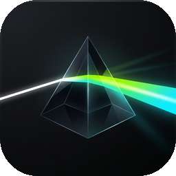
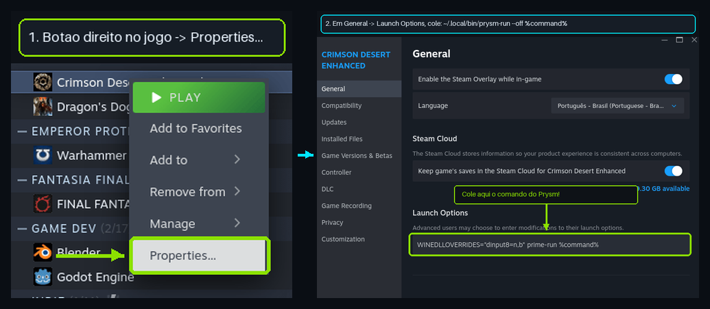

<p align="center">
  
</p>

<h1 align="center">Prysm</h1>
<p align="center">
  <b>Filtro Neural DLSS 5 + Overlay In-Game para Linux (Vulkan &amp; Proton) — sem copiar nenhuma DLL para a pasta do jogo.</b>
</p>

---

## O que é o Prysm?

O **Prysm** é um launcher, painel de controle (PyQt6) e **overlay flutuante in-game** (GTK4 + `Gtk4LayerShell` para Wayland/Hyprland) que integra o filtro neural **DLSS 5 (`DLSS5VKLayer`)** em qualquer jogo Vulkan ou Proton/Steam de forma limpa:

- **Zero arquivos na pasta do jogo:** usa uma *Vulkan Implicit Layer* (`VKLayer_DLSS5=1`) + wrapper `prysm-run %command%`.
- **NVIDIA PRIME Offload automático:** em notebooks híbridos (iGPU + RTX), o `prysm-run` já ativa `__NV_PRIME_RENDER_OFFLOAD=1`, `__VK_LAYER_NV_optimus=NVIDIA_only` e `__GLX_VENDOR_LIBRARY_NAME=nvidia` para o jogo.
- **Overlay In-Game (`Page Up` ou `Delete`):** abre diretamente por cima de jogos em tela cheia com `KeyboardMode.EXCLUSIVE` (libera o cursor do sistema sem interagir com o jogo; aperte `Page Up` ou `Esc` para voltar ao jogo).
- **Modo `--off` para carregamento rápido:** inicie o jogo com o filtro desligado para carregar menus/shaders rápido e ative manualmente quando estiver in-game.
- **Preset otimizado `Realista & Eficiente (FP8 0.70x)`:** usa o modelo FP8 (`310.9.16`) em escala neural reduzida (`0.70x`) com debounce automático no slider de escala para evitar travamentos por reconstrução excessiva na VRAM.

---

## Como usar na Steam (Passo a Passo)



1. Na biblioteca da Steam, clique com o **botão direito** no jogo e abra **Properties...** (*Propriedades*).
2. Na aba **General** (*Geral*), encontre o campo **Launch Options** (*Opções de Inicialização*) e cole um dos comandos abaixo:

| Modo | Comando para colar em **Launch Options** |
| :--- | :--- |
| **Recomendado (inicia OFF, liga in-game)** | `~/.local/bin/prysm-run --off %command%` |
| **Direto (já inicia ligado)** | `~/.local/bin/prysm-run %command%` |
| **Com mods `dinput8.dll` (ex: REFramework)** | `WINEDLLOVERRIDES="dinput8=n,b" ~/.local/bin/prysm-run --off %command%` |

*(Na Steam, se `~/.local/bin` não estiver no `PATH`, use o caminho completo `/home/SEU_USUARIO/.local/bin/prysm-run` — a aba **Como Usar (Steam)** dentro do próprio app Prysm já gera o caminho exato com botão de copiar!)*

---

## Atalhos e Controles In-Game

- **`Page Up`** *(padrão)* ou **`Delete`** *(trocável no rodapé do overlay)*: abre/fecha o **Prysm Overlay** por cima do jogo.
  - O atalho só fica ativo no Hyprland enquanto o overlay/jogo está rodando; ao fechar, `Page Up` volta ao comportamento normal no navegador/sistema.
- **`Esc`**: oculta o overlay e devolve o foco e o mouse para o jogo.
- **Controles ao vivo no Overlay:**
  - `Filtro Ativo` (ON/OFF instantâneo) e `Cortina A/B (50/50)`
  - Passagens neurais rápidas: **`1x`**, **`2x`**, **`3x`**, **`5x`**
  - Presets prontos (`Realista & Eficiente (FP8 0.70x)`, `Natural Sutil`, `Cinematográfico`, etc.)
  - Sliders em tempo real: **Intensidade**, **Escala Neural** *(com debounce de 350 ms)*, **Nitidez**, **Estrutura Local**, **Tom Local** e **Divisão da Cortina**.

---

## Instalação

### Requisitos
- Linux com GPU NVIDIA compatível (RTX) + driver Vulkan recente
- Python 3.11+, `PyQt6` (para o app principal), `gtk4` + `gtk4-layer-shell` + `python-gobject` (para o overlay Wayland)
- Proton / DW-Proton instalado na Steam (para o `dlssnr-helper`)

### Passos
```bash
git clone https://github.com/Sapyst/Prysm.git
cd Prysm
./install.sh
prysm setup
```

* Para abrir o inicializador/painel antes do jogo: busque **Prysm** no menu de aplicativos ou rode `prysm` no terminal.
* **Dica para Steam (`pressure-vessel`):** se o seu `/tmp` for um `tmpfs` pequeno (ex: 2 GB), configure `shm=/home/SEU_USUARIO/.cache/dlssnr/shm.bin` em `~/.config/dlssnr/config.ini` — fica acessível dentro do container da Steam e evita erro de cota de disco.

---

## Dicas de Desempenho e Baixa Latência

- **Prefira `1x` + `FP8 Otimizado` + `Escala Neural 0.65x–0.70x`:** entrega o melhor equilíbrio entre realismo e fluidez.
- **Sentiu delay no mouse?** Desative o **DLSS Frame Generation** no menu do jogo quando estiver usando o filtro neural (mantenha apenas DLSS Upscale + NVIDIA Reflex), pois o FG soma latência de fila ao tempo da passagem neural.

---

## Aviso Legal & Créditos

- Este repositório **não redistribui** nenhum binário proprietário da NVIDIA (`nvngx_dlssnr.dll`). O usuário fornece ou baixa os componentes localmente via `prysm setup`.
- Construído sobre a arquitetura de camada Vulkan `DLSS5VKLayer`.
